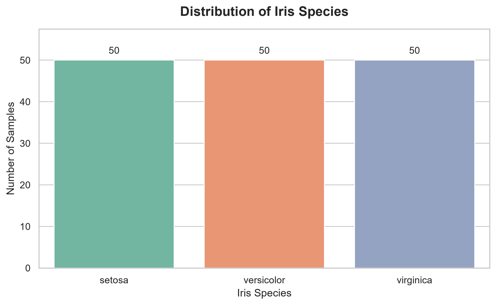
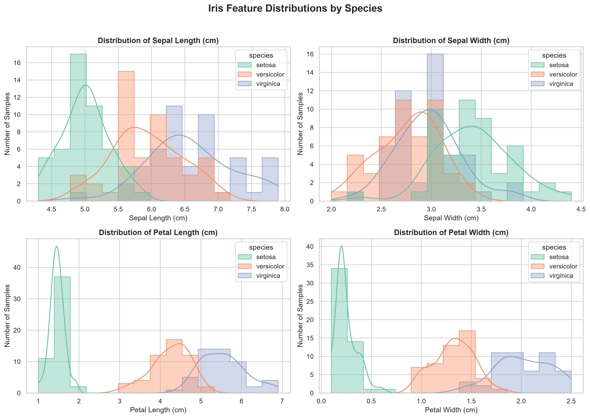
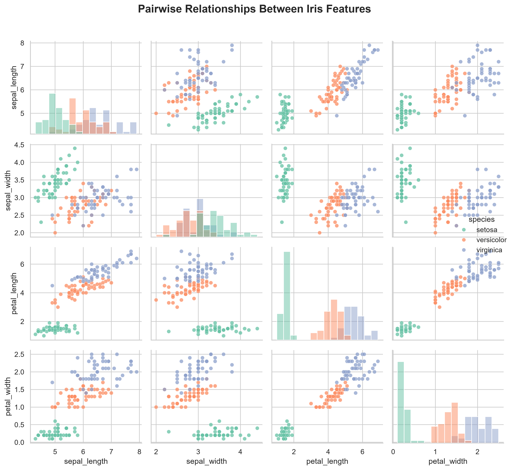
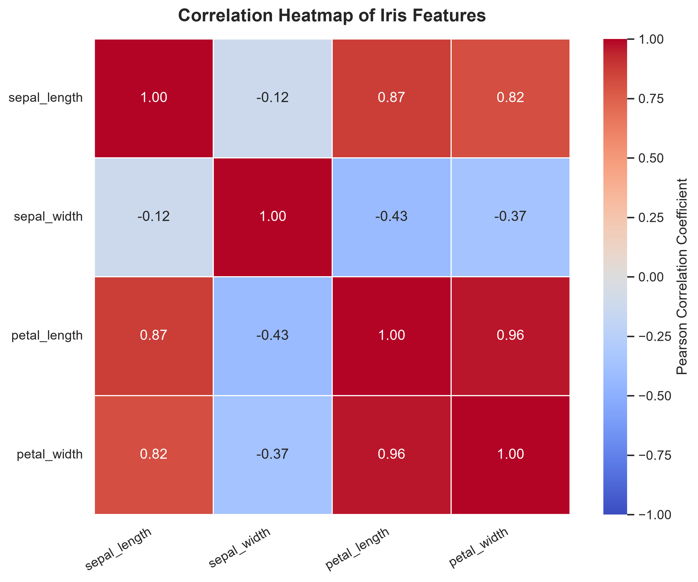
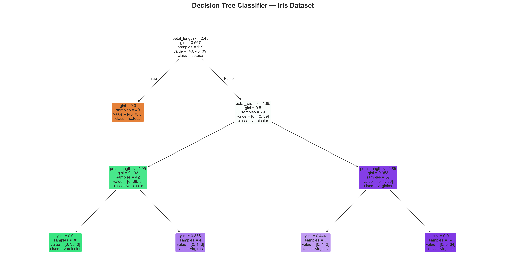
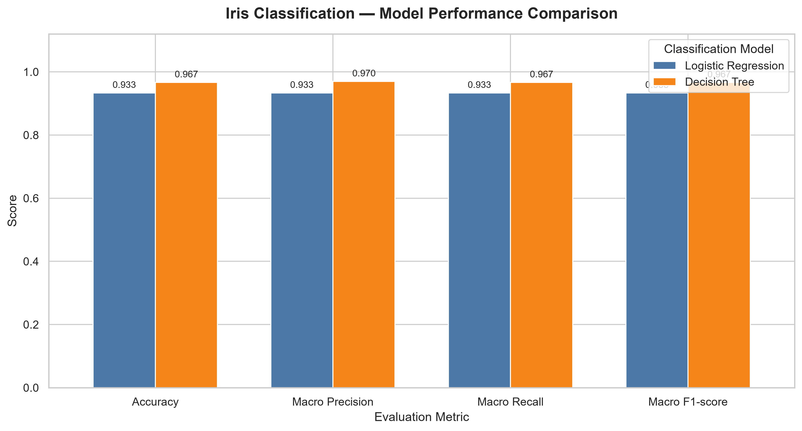
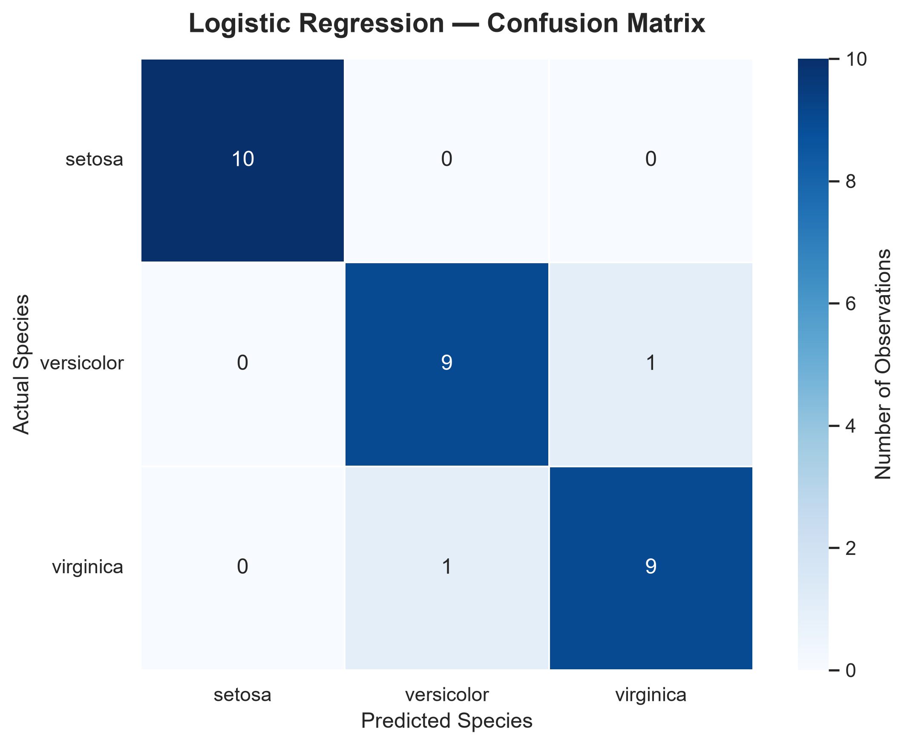
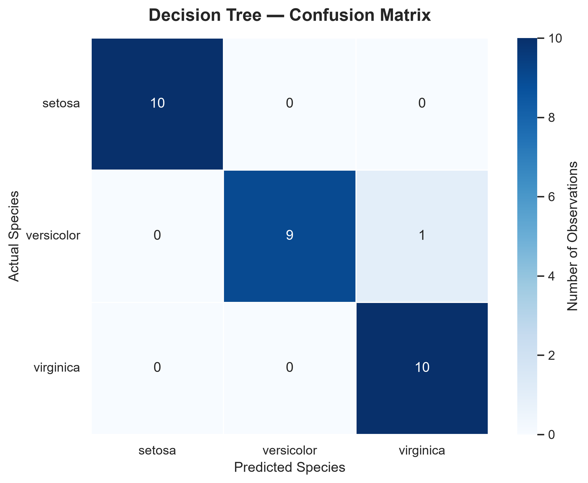
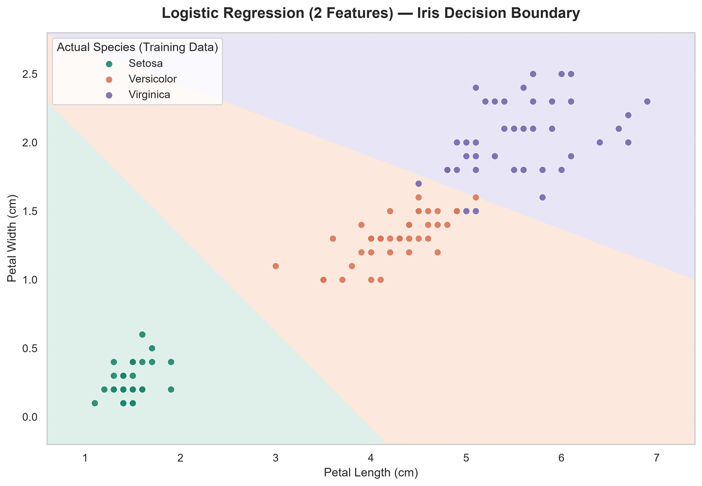
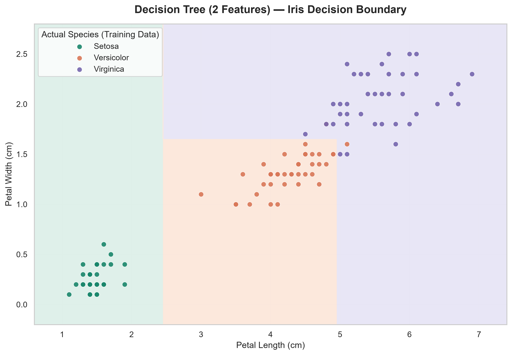

# Task 01 — Multi-Class Iris Flower Classification

## 1. Project Overview

This project was developed as part of the **Datheon Machine Learning & Data Science Internship**.

The objective is to classify Iris flowers into three species—**setosa, versicolor, and virginica**—using supervised machine learning algorithms.

Two classification models were implemented and evaluated:

- Logistic Regression
- Decision Tree Classifier

The project covers exploratory data analysis, data preprocessing, model training, evaluation, and decision boundary visualization.

All experiments were implemented in Python using Scikit-Learn, Pandas, NumPy, Matplotlib, and Seaborn.

## 2. Dataset Description

The Iris dataset contains measurements of flower characteristics used to identify the corresponding species.

| Property | Description |
|---|---|
| Original observations | 150 |
| Observations after duplicate removal | 149 |
| Numerical features | 4 |
| Target variable | `species` |
| Classification type | Multi-class classification |
| Number of classes | 3 |
| Missing values | 0 |
| Exact duplicates identified | 1 |

### Input Features

| Feature | Description |
|---|---|
| `sepal_length` | Sepal length in centimetres |
| `sepal_width` | Sepal width in centimetres |
| `petal_length` | Petal length in centimetres |
| `petal_width` | Petal width in centimetres |

The target variable, `species`, contains three classes: setosa, versicolor, and virginica.

**Dataset file:** [`data/iris.csv`](data/iris.csv)

## 3. Project Workflow

The machine learning workflow consists of the following stages:

1. Load and inspect the Iris dataset.
2. Perform exploratory data analysis (EDA).
3. Identify and remove exact duplicate observations.
4. Separate input features and target labels.
5. Apply an 80:20 stratified train-test split.
6. Standardize features for Logistic Regression using training data only.
7. Train Logistic Regression and Decision Tree classifiers.
8. Evaluate both models on the same held-out test dataset.
9. Generate confusion matrices and compare classification metrics.
10. Train separate two-feature models for decision boundary visualization.
11. Verify the notebook and export the results.

## 4. Exploratory Data Analysis

EDA was performed to understand the dataset, examine class distributions, and identify relationships between numerical features.

The analysis included descriptive statistics, class distribution plots, feature histograms, pair plots, and a Pearson correlation heatmap.

### Class Distribution



The original dataset contained 50 observations for each species, indicating a balanced class distribution before duplicate removal.

### Numerical Feature Distributions



The feature distributions demonstrate differences in flower measurements among the three species.

### Feature Relationships



The pair plot shows that petal length and petal width provide useful separation between the Iris species, particularly setosa. Versicolor and virginica exhibit some overlap.

### Correlation Analysis



Petal length and petal width show a strong positive Pearson correlation of approximately 0.96.

Sepal length also has strong positive correlations with petal length and petal width.

All four features were retained for the main classification experiments.

## 5. Data Preprocessing

### 5.1 Duplicate Handling

One exact duplicate observation was identified and removed from a separate modelling dataset.

The original dataset was preserved.

After cleaning, **149 unique observations** remained.

### 5.2 Feature and Target Separation

The four numerical measurements were used as input features (`X`), while the categorical `species` column was used as the target variable (`y`).

### 5.3 Stratified Train-Test Split

An 80:20 stratified split was performed using `random_state=42`.

| Subset | Observations |
|---|---:|
| Training | 119 |
| Testing | 30 |
| Total | 149 |

Stratification maintained approximately equal proportions of the three Iris species in the training and testing subsets.

### 5.4 Feature Standardization

`StandardScaler` was used for Logistic Regression.

To prevent data leakage:

- The scaler was fitted only on training features.
- The fitted scaler transformed both training and testing features.
- The test dataset was not used to estimate scaling parameters.

Decision Tree was trained using the original, unscaled measurements.

## 6. Classification Models

### 6.1 Logistic Regression

A multinomial Logistic Regression classifier was trained using the four standardized numerical features.

**Configuration:**

| Parameter | Value |
|---|---|
| Solver | `lbfgs` |
| Maximum iterations | 1000 |
| Regularization parameter `C` | 1.0 |
| Random state | 42 |

The classifier learned all three Iris species.

### 6.2 Decision Tree

A Decision Tree classifier was trained using the original numerical measurements.

**Configuration:**

| Parameter | Value |
|---|---|
| Splitting criterion | Gini impurity |
| Maximum depth | 3 |
| Random state | 42 |

The maximum depth was restricted to limit model complexity.

### Decision Tree Structure



The tree diagram illustrates the learned feature thresholds and classification rules.

## 7. Model Evaluation

Both models were evaluated on the **same 30 held-out test observations**.

The evaluation metrics included accuracy, macro-averaged precision, macro-averaged recall, and macro-averaged F1-score.

### 7.1 Performance Comparison

| Metric | Logistic Regression | Decision Tree |
|---|---:|---:|
| Accuracy | 93.33% | **96.67%** |
| Macro Precision | 0.9333 | **0.9697** |
| Macro Recall | 0.9333 | **0.9667** |
| Macro F1-score | 0.9333 | **0.9666** |
| Correct predictions | 28 | **29** |
| Incorrect predictions | 2 | **1** |



**Numerical results:** [`outputs/iris_model_comparison.csv`](outputs/iris_model_comparison.csv)

### 7.2 Logistic Regression Confusion Matrix



The Logistic Regression classifier correctly identified 28 out of 30 test observations.

Its two errors were:

- One versicolor observation incorrectly classified as virginica.
- One virginica observation incorrectly classified as versicolor.

All 10 setosa observations were correctly classified.

### 7.3 Decision Tree Confusion Matrix



The Decision Tree classifier correctly identified 29 out of 30 test observations.

Its only error was one versicolor observation incorrectly classified as virginica.

All setosa and virginica test observations were correctly classified.

### 7.4 Discussion

Decision Tree achieved a slightly higher accuracy than Logistic Regression on the selected test split.

The accuracy difference was approximately **3.33 percentage points**, representing one additional correct prediction.

Both models performed well on setosa, while the classification errors were concentrated between versicolor and virginica.

These findings are consistent with the overlap between the petal measurements observed during EDA.

However, the relatively small test dataset means that the performance difference should be interpreted cautiously. The results do not establish that Decision Tree will consistently outperform Logistic Regression on other datasets or random splits.

## 8. Decision Boundary Visualization

Two additional classifiers were trained using only petal length and petal width to visualize classification boundaries in two dimensions.

These models were developed specifically for visualization and are separate from the original four-feature classifiers.

### Logistic Regression Decision Boundary



The visualization illustrates the approximately linear boundaries produced by multinomial Logistic Regression in the selected two-dimensional feature space.

### Decision Tree Decision Boundary



The Decision Tree produces axis-aligned decision regions based on feature threshold splits.

**Important:** The reported test accuracies of 93.33% and 96.67% belong to the original four-feature models, not the visualization-only models.

## 9. Project Structure

```text
Task_01_Multi_Class_Classification/
├── data/
│   └── iris.csv
├── notebooks/
│   └── iris_classification.ipynb
├── outputs/
│   ├── iris_class_distribution.png
│   ├── iris_feature_distributions.png
│   ├── iris_pairplot.png
│   ├── iris_correlation_heatmap.png
│   ├── iris_decision_tree_structure.png
│   ├── iris_logistic_confusion_matrix.png
│   ├── iris_decision_tree_confusion_matrix.png
│   ├── iris_model_performance_comparison.png
│   ├── iris_model_comparison.csv
│   ├── iris_logistic_decision_boundary.png
│   └── iris_decision_tree_decision_boundary.png
└── README.md
```

## 10. Technologies and Libraries

The project was implemented using:

- Python
- Pandas and NumPy
- Scikit-Learn
- Matplotlib and Seaborn
- Jupyter Notebook
- Visual Studio Code

## 11. How to Run the Project

1. Clone the repository and open it in Visual Studio Code.
2. Create and activate a Python virtual environment.
3. Install the dependencies from the repository's root `requirements.txt`.
4. Open the Iris classification notebook.
5. Select the configured Python Jupyter kernel.
6. Restart the kernel and execute all cells.

**Notebook:** [`notebooks/iris_classification.ipynb`](notebooks/iris_classification.ipynb)

From the repository root, dependencies can be installed with:

```bash
python -m pip install -r requirements.txt
```

The notebook loads the CSV dataset, performs the analysis, trains the classifiers, calculates evaluation metrics, and generates the output figures.

The project was developed and verified using a Python 3.14 environment.

## 12. Limitations

Although both classifiers achieved high accuracy on the selected test data, the experiment has several limitations.

- **Small dataset:** The cleaned dataset contains only 149 observations.
- **Single train-test split:** Performance was evaluated on one stratified split rather than repeated splits or cross-validation.
- **Small test set:** Each incorrect prediction changes overall accuracy by approximately 3.33 percentage points.
- **Limited hyperparameter exploration:** The classifiers were evaluated using predefined configurations rather than an extensive tuning procedure.
- **Generalization:** Performance on this particular Iris dataset does not guarantee equivalent results on other flower datasets or real-world measurements.
- **Two-dimensional visualizations:** Decision boundary plots use two features and do not directly represent the full four-dimensional classifiers.

Future work could include stratified cross-validation, training-only hyperparameter tuning, additional classification algorithms, and evaluation on a larger dataset.

## 13. Conclusion

This project successfully implemented and evaluated Logistic Regression and Decision Tree classifiers for multi-class Iris flower classification.

Both algorithms achieved strong performance on the held-out test dataset.

Logistic Regression achieved **93.33% accuracy**, while Decision Tree achieved **96.67% accuracy**.

Decision Tree performed slightly better on the selected test split, although the difference represented only one additional correct prediction.

The experiment demonstrates a complete supervised machine learning workflow, including exploratory analysis, leakage-aware preprocessing, model development, performance evaluation, visual interpretation, and reproducible documentation.

## 14. Internship Project

**Internship:** Datheon Machine Learning & Data Science Internship  
**Task:** 01 — Multi-Class Classification  
**Status:** Completed

This project is part of the Datheon Machine Learning & Data Science Internship portfolio.
